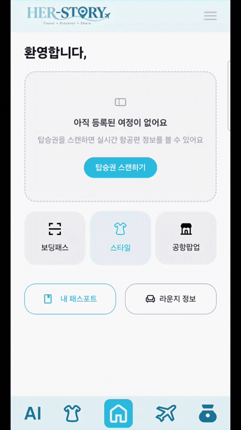

# ✈️ MCM Nomad Passport | HER-STORY

> **출국 전 준비 → 공항 내 서비스 → 귀국 후**까지 하나의 여정으로 연결하는 Next.js 웹 애플리케이션

<p align="center">
  <a href="./docs/PROJECT_SHOWCASE.md">
    
  </a>
  <a href="https://youtu.be/BJ0BpAu07PA">
    
  </a>
  <a href="https://hwkong7-portfolio.vercel.app/">
    
  </a>
</p>

---

## 🎬 프로젝트 시연 영상

<p align="center">
  <a href="https://youtu.be/BJ0BpAu07PA">
    
  </a>
</p>

<p align="center">
  <sub>이미지를 클릭하면 YouTube에서 전체 시연 영상을 볼 수 있습니다.</sub>
</p>

---

## 🧳 주요 기능 시연

<p align="center">
  
</p>

<p align="center">
  <sub>
    탑승권을 스캔해 여정을 등록하는 흐름.<br />
    저장된 여정 ID가 서버에서 사라진 경우에도 화면이 멈추지 않고<br />
    첫 화면(탑승권 스캔 안내)으로 복귀합니다.
  </sub>
</p>

---

## 🛠️ 기술 스택

| 분류 | 기술 |
| --- | --- |
| Framework | Next.js 16 (App Router), React 19 |
| Language | TypeScript |
| Styling | Tailwind CSS 4 |
| Server State | TanStack Query |
| Client State | Zustand |
| HTTP Client | axios |
| QR Scanner | jsQR |
| Testing | Vitest, Testing Library |

---

## 🚀 시작하기

### 요구 사항

- Node.js 20 이상

### 환경 변수

프로젝트 루트에 `.env.local` 파일을 만들고 API 서버 주소를 설정합니다.

```env
NEXT_PUBLIC_API_BASE_URL=https://api.example.com
```

### 설치 및 실행

```bash
npm install
npm run dev
```

브라우저에서 [http://localhost:3000](http://localhost:3000)을 엽니다.

### 스크립트

| 명령어 | 설명 |
| --- | --- |
| `npm run dev` | 개발 서버 실행 |
| `npm run build` | 프로덕션 빌드 |
| `npm run start` | 빌드된 앱 실행 |
| `npm run lint` | ESLint 검사 |
| `npm test` | Vitest 테스트 실행 |

---

## 📁 프로젝트 구조

```text
app/                  라우트 정의 (App Router)
  (preflight)/         출국 전: 홈, 보딩패스, 마이페이지, 스타일, 팝업 등
  (airport)/           공항 내: 셀프 체크인, VIP 피팅, 패스트 체크아웃, 공항 지도
  (postflight)/        귀국 후: 가죽 케어, 매장 지도, 마일리지
  (auth)/              로그인, 회원가입, 비밀번호 찾기
  showcase/            프로젝트 소개 페이지

features/              도메인별 화면과 전용 컴포넌트
  preflight/
  airport/
  postflight/
  auth/

components/            공용 컴포넌트 (layout, icons, ui, scan, signature)
hooks/                 공용 React Query 훅
store/                 Zustand 전역 상태
utils/                 포맷팅 등 순수 유틸 함수
types/                 API 응답 및 도메인 타입
constants/             라우트 상수 등 앱 전역 상수
api/                   API 클라이언트

docs/
  demo-scan.gif
  PROJECT_SHOWCASE.md
```

각 `page.tsx`는 `features/`의 화면 컴포넌트를 렌더링하는 역할을 담당합니다.

라우트 경로는 하드코딩하지 않고 `constants/routes.ts`의 `ROUTES` 객체를 통해 참조합니다.

---

## 🧪 테스트

[Vitest](https://vitest.dev/) + [Testing Library](https://testing-library.com/)를 사용합니다.

```bash
npm test
npm run test:watch
```

실패 상황 처리처럼 화면에서 재현하기 번거로운 로직을 우선 테스트했습니다.

### 1. 로그인 오류 처리

`features/auth/pages/__tests__/resolveLoginErrorMessage.test.ts`

응답을 받지 못한 경우(네트워크·타임아웃)와 서버가 오류를 내려준 경우에 서로 다른 안내 문구가 표시되는지 검증합니다.

같은 메시지라도 `status` 유무에 따라 결과가 달라져야 합니다.

### 2. 무효화된 여정 상태 복구

`hooks/__tests__/useClearStaleJourney.test.tsx`

여정 조회가 실패하면 로컬에 저장된 `journeyId`를 비워, 사용자가 탑승권 스캔 화면에서 다시 시작할 수 있는지 검증합니다.

---

## 👩‍💻 담당 역할 및 기여

**5인 팀 프로젝트**에서 프론트엔드 개발을 담당했습니다.

### 01. 인증 화면 구현

- 로그인
- 회원가입
- 비밀번호 찾기

### 02. 공통 로딩·에러 UI 설계

- `WakingScreen` — 17개 화면에서 사용
- `ErrorState` — 14개 화면에서 사용

여러 화면에서 공통으로 사용하는 로딩·오류 UI를 설계했습니다.

### 03. 서버 상태 오류에 대한 복구 처리

- `useClearStaleJourney` 훅 작성
- 서버에서 여정 정보가 무효화되었을 때 로컬 상태 정리
- 사용자가 탑승권 스캔 화면에서 다시 시작할 수 있도록 처리

### 04. 웹 접근성 개선

- 아이콘만으로 구성된 하단 네비게이션 등에 `aria-label` 부여

---

## 🔗 관련 링크

- 🎨 [프로젝트 상세 소개](./docs/PROJECT_SHOWCASE.md)
- 🎬 [전체 시연 영상 (YouTube)](https://youtu.be/BJ0BpAu07PA)
- 💻 [GitHub Repository](https://github.com/hwkong7/mcm-nomad-frontend)
- 🌷 [개인 포트폴리오](https://hwkong7-portfolio.vercel.app/)
- 📱 [프로젝트 사용](https://herstory-frontend.vercel.app/login)

---

<p align="center">
  <sub>MCM Nomad Passport · HER-STORY</sub>
</p>
